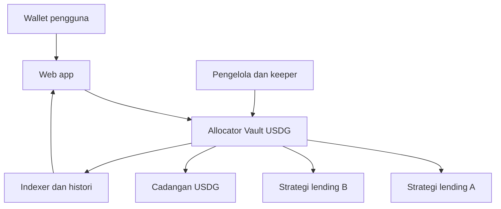

# Managed Strategy Vaults — Developer Master Brief

**Tanggal:** 18 November 2026 · Asia/Makassar  
**Network:** Robinhood Chain  
**Arsitektur yang disetujui:** Yearn V3 sebagai fondasi teknis; Kassora sebagai referensi produk dan pengalaman pengguna.  
**Nama:** belum diputuskan. Rekomendasi sementara: **Avenor**.  
**Status dokumen:** spesifikasi implementasi; bukan laporan bahwa kontrak sudah deployed, diaudit, atau menghasilkan keuntungan.

## 1. Arahan produk

Bangun platform managed strategy vaults di Robinhood Chain. Pengguna memilih mandat investasi, membaca strategi, alokasi, biaya, serta kondisi penarikan, kemudian menyetor aset dari wallet ke vault milik produk kita. Vault menerbitkan shares dan menempatkan aset ke strategi yang diizinkan. Pengguna memantau posisi dan menarik aset sesuai kondisi likuiditas aktual.

Gunakan **Yearn V3 untuk mesin vault**, dengan perubahan sesedikit mungkin pada core. Gunakan **Kassora untuk referensi katalog mandat, hierarki informasi, dashboard strategi, dan penyajian transparansi**. Implementasikan frontend dengan identitas sendiri. Jangan menggabungkan dua mesin perhitungan dana yang terpisah atau menyalin angka referensi menjadi angka produksi.

Hasil akhir harus mencakup kontrak, integrasi sumber yield, aplikasi, indexer, keeper, pengelolaan peran, dokumentasi, serta bukti transaksi. Landing page dan kontrak kosong belum memenuhi delivery.

### Keputusan dan asumsi

| Area | Keputusan |
|---|---|
| Fondasi kontrak | Yearn V3 Allocator Vault; strategi ERC-4626 yang kompatibel |
| Referensi produk | Kassora; bukan ketergantungan pada kontrak Kassora |
| Network | Robinhood Chain; testnet sebelum rilis mainnet |
| Aset rilis awal | USDG; alamat dan decimals diverifikasi sebelum implementasi transaksi |
| Produk pertama | USDG Managed Yield: alokasi ke sumber lending/savings yang diverifikasi |
| Pengelola | Tim/curator dengan kewenangan terbatas dan terlihat publik |
| Otomatisasi | Keeper untuk report dan operasi terbatas; tidak wajib AI |
| Katalog lengkap | Mendukung mandat lending, treasury, basis, relative value, macro, custom; status aktivasi per mandat |
| Brand | Nama, logo, domain, ticker belum final; jangan mengunci identitas berdasarkan usulan |
| Token protokol | Tidak diperlukan untuk deposit, shares, dan operasi vault; belum menjadi scope ekonomi token |
| Fees | Infrastruktur mendukung biaya; besaran komersial belum ditetapkan |

Pemilihan satu vault untuk aktivasi pertama merupakan urutan delivery. Developer tetap menyiapkan arsitektur dan backlog seluruh katalog. Mandat yang belum siap ditampilkan sebagai research/planned tanpa deposit dan tanpa performance fiktif.

## 2. Usulan nama

| Nama | Pertimbangan |
|---|---|
| **Avenor** | Rekomendasi utama. Terdengar seperti brand pengelolaan aset dan cukup luas untuk beberapa mandat. |
| **Aurest** | Asosiasi cadangan dan akumulasi; cocok untuk positioning yang tenang. |
| **Velden** | Pendek, mudah diterapkan ke nama vault dan antarmuka. |
| **Veyra** | Ringkas dan fleksibel untuk produk investasi. |

Ini ide kreatif, bukan pernyataan ketersediaan merek, domain, ticker, atau akun sosial. Gunakan `PROJECT_NAME` di konfigurasi sampai owner menetapkan nama. Contoh `Avenor USDG Managed Yield` hanya ilustrasi penamaan. Jangan membuat token, membeli domain, atau mendaftarkan akun dari dokumen ini.

## 3. Referensi utama dan cara menggunakannya

### 3.1 Kassora — produk dan UX

| Referensi | URL | Tujuan |
|---|---|---|
| Website | https://kassora.org/ | Bahasa visual, katalog mandat, hierarki strategi |
| Aplikasi | https://kassora.org/app | Navigasi vault, detail strategi, transaksi |
| Portfolio | https://kassora.org/app/portfolio | Penyajian posisi pengguna |
| Contracts | https://kassora.org/app/contracts | Transparansi alamat dan status deployment |
| Docs | https://kassora.org/app/docs | Penjelasan aset, shares, alokasi, penarikan |
| Overview resmi | https://github.com/kassoradev/kassora-overview | Konsep USDG → shares → curator → strategi |

**Batas bukti observasi:** website berupa aplikasi JavaScript. Riset sebelumnya membaca HTML/build publik dan README resmi melalui pengambilan read-only. Itu bukan inspeksi lengkap seluruh state desktop/mobile atau transaksi wallet. Developer harus membuat capture register sendiri sebelum menetapkan visual parity.

Saat diperiksa, website memasarkan enam mandat, sedangkan README menjelaskan produk awal USDG/kUSDG. Status publik menyebut pre-launch, audit dan deployment vault belum selesai. Grafik/angka referensi bukan rekam jejak investasi pengguna. Perbedaan website dan repo harus dicatat; jangan menyalin asumsi yang bertentangan ke produk kita. Route yang bergantung pada SPA perlu dibuka dari navigasi aplikasi bila direct link gagal.

### 3.2 Yearn — fondasi teknis

| Referensi | URL | Tujuan |
|---|---|---|
| Produk | https://yearn.fi/ | UX vault aktif dan penjelasan sumber yield |
| V3 developer overview | https://docs.yearn.fi/developers/v3/overview | Hub dokumentasi; strategi dan allocator |
| Vault management | https://docs.yearn.fi/developers/v3/vault_management | Konfigurasi deployment dan peran |
| Strategy writing | https://docs.yearn.fi/developers/v3/strategy_writing_guide | Pembuatan integrasi strategi |
| Vault core | https://github.com/yearn/yearn-vaults-v3 | Source vault dan factory |
| Vault releases | https://github.com/yearn/yearn-vaults-v3/releases | Pemilihan versi yang ditinjau |
| Technical specification | https://github.com/yearn/yearn-vaults-v3/blob/master/TECH_SPEC.md | Semantik akuntansi dan batas integrasi; baca versi pinned untuk implementasi |
| Tokenized Strategy | https://github.com/yearn/tokenized-strategy | Source implementasi strategi |
| Strategy releases | https://github.com/yearn/tokenized-strategy/releases | Pin versi strategi secara terpisah |
| Periphery | https://github.com/yearn/vault-periphery | Modul pendukung; pilih path aktual pada commit terpilih |
| Router | https://github.com/yearn/Yearn-ERC4626-Router | Referensi transaksi bertingkat dan batas hasil |
| Protocol fees | https://docs.yearn.fi/developers/v3/protocol_fees | Verifikasi biaya factory dan penerimanya |
| ERC-4626 | https://eips.ethereum.org/EIPS/eip-4626 | Standar interface assets/shares |

**Temuan versi, bukan pin implementasi:** halaman release yang diperiksa menampilkan `v3.1.1` untuk vault dan Tokenized Strategy. Developer harus memilih versi berdasarkan cakupan audit, kompatibilitas, perubahan perilaku, dan uji fork; mencatat full commit SHA dan compiler untuk setiap repo. Nomor versi sama tidak membuktikan seluruh kombinasi modul kompatibel.

Dokumentasi dan `master` dapat mendahului deployment. Repo strategi memperingatkan penggunaan release resmi untuk produksi. Jangan menyalin alamat implementasi/factory lintas chain tanpa memverifikasi bytecode dan konfigurasi. Lisensi repo core/strategy yang diperiksa adalah AGPL-3.0; inventarisasi lisensi setiap komponen, simpan notices, dan dokumentasikan kewajiban distribusi/source yang berlaku pada implementasi.

### 3.3 Robinhood Chain

| Referensi | URL |
|---|---|
| Konfigurasi jaringan | https://docs.robinhood.com/chain/connecting/ |
| Kontrak token | https://docs.robinhood.com/chain/ — gunakan navigasi Token Contracts terkini |
| Mainnet explorer | https://robinhoodchain.blockscout.com/ |

Konfigurasi dokumentasi resmi saat diperiksa: mainnet `4663`, testnet `46630`, gas ETH. Public RPC mainnet `https://rpc.mainnet.chain.robinhood.com`, testnet `https://rpc.testnet.chain.robinhood.com`. Gunakan provider produksi dengan historical/archive access dan fallback, bukan public RPC tunggal untuk indexer/keeper. Verifikasi ulang konfigurasi sebelum deploy.

## 4. Nilai produk dan pembeda

**Deskripsi kerja:** managed onchain vaults dengan mandat yang jelas, alokasi yang bisa diperiksa, dan operasi melalui kontrak di Robinhood Chain.

Pengguna memilih berdasarkan sumber hasil, eksposur, biaya, likuiditas, dan kewenangan pengelola. Jangan menyamakan APY tinggi dengan kualitas strategi atau menyebut infrastruktur Yearn sebagai jaminan keamanan.

Pembeda yang harus diwujudkan:

1. Satu detail vault yang menjelaskan mandat dan batas investasi secara konkret.
2. Alokasi aktual beserta alamat sumber yield dan perubahan historisnya.
3. Hasil bersih yang memisahkan laba/rugi dari deposit dan withdraw.
4. Informasi penarikan: tersedia saat ini, keterbatasan venue, serta estimasi yang diberi timestamp.
5. Perubahan parameter dan kewenangan pengelola yang dapat ditelusuri.

Produk ini mengoperasikan vault sendiri. Mengarahkan user ke deposit pihak ketiga tanpa lapisan pengelolaan kita tidak memenuhi konsep yang disetujui.

## 5. Katalog mandat dan syarat aktivasi

| Mandat | Desain | Syarat sebelum menerima deposit |
|---|---|---|
| **USDG Managed Yield** | Beberapa strategi lending/savings USDG + cadangan likuiditas | Venue dan asset valid; uji deposit, alokasi, report, recall, withdraw; caps dan fees terpasang |
| Treasury Reserve | Eksposur treasury jangka pendek | Instrumen/issuer/custodian nyata, akses transfer/redemption, pricing, waktu settlement dan syarat eligibility tervalidasi |
| ETH Basis & Funding | Spot ETH dengan short derivatif untuk mengurangi delta | Venue tersedia, margin dan funding accounting, mark-to-market, hedge monitoring, liquidation dan unwind diuji |
| Cross-Venue Relative Value | Menangkap perbedaan harga antarvenue | Ketersediaan venue, inventory, biaya eksekusi, slippage, settlement dan risiko leg terbuka diuji |
| Macro / Rate Divergence | Strategi spread suku bunga/mata uang | Instrumen yang benar-benar dapat diakses, oracle, leverage, valuasi dan settlement tervalidasi |
| Custom Mandates | Konfigurasi khusus depositor/treasury | Kebijakan deposit/transfer, parameter risiko, biaya, valuasi dan exit yang spesifik |

Jangan menjual Treasury Reserve sebagai strategi onchain murni jika aset dasarnya melibatkan kustodian. Market-neutral adalah target eksposur, bukan bebas risiko. Strategi lintas chain/venue membutuhkan desain tambahan; tidak menjadi kemampuan otomatis Yearn.

## 6. Arsitektur sistem

Satu vault utama memiliki satu underlying asset. Strategi anak wajib kompatibel dengan asset dan interface yang dibutuhkan versi vault terpilih. Strategi ETH memerlukan vault underlying yang sesuai atau desain konversi yang eksplisit; jangan memasukkan ETH dan USDG ke vault yang sama tanpa aturan valuasi dan eksekusi.

Jalur dana awal: wallet → vault utama → strategi → venue. User memegang shares vault utama; shares strategi dimiliki vault utama sesuai integrasi. UI tidak boleh menjumlahkan underlying dan receipt token menjadi TVL ganda. Struktur bertingkat dapat memiliki lebih dari satu lapisan fees; semua lapisan harus terlihat.

### Modul delivery

| Modul | Implementasi |
|---|---|
| Allocator vault/factory | Adaptasi minimal Yearn core dari versi pinned |
| Strategy layer | Pakai strategi ERC-4626 yang kompatibel atau adapter/Tokenized Strategy sendiri bila perlu |
| Allocation controller | Proposal alokasi, batas target, idle reserve, eksekusi terbatas; gunakan modul upstream bila cocok |
| Fee accountant | Modul yang dipilih sesuai release; biaya dan penerima terkonfigurasi jelas |
| Role/timelock layer | Pemetaan izin Yearn ke pengelola produk; perubahan sensitif melalui kontrol yang teruji |
| Registry | Identitas vault, strategi, versi mandat, chain, status dan metadata |
| Web app | Katalog, detail, transaksi, portfolio, transparansi, operator console |
| Indexer/API | Ledger dan snapshot yang dapat direkonsiliasi dari event serta reads |
| Keeper | Report, monitoring, dan alokasi terbatas bila diaktifkan |

Jangan membuat proxy upgradeable baru di depan core hanya untuk memudahkan branding. Pilihan upgrade/migrasi harus diputuskan dari karakteristik kontrak terpilih; tampilkan pengendali upgrade dan mekanisme perpindahan posisi jika ada.

## 7. Kontrak, accounting, dan integrasi

### 7.1 Rilis dan konfigurasi yang dapat direproduksi

Sebelum implementasi transaksi, buat `BASELINE.md`: repo, release/tag, full commit, compiler/optimizer, dependency lock, cakupan audit, known issues, chain support, serta perbedaan terhadap upstream. Catat modul yang dipakai dan yang dibangun sendiri. Jangan mengganti core Vyper dengan rewrite Solidity tanpa alasan teknis dan review tersendiri. Strategi/periphery dapat memakai bahasa sesuai source terpilih.

Factory, implementasi strategi, accountant, role manager, registry dan router adalah deployment terpisah yang harus diverifikasi. Jika memakai deployment pihak lain, dokumentasikan owner, pengaturan fees, versi dan trust dependency. Jika deploy sendiri, verifikasi source dan seluruh role serta alamat tujuan.

### 7.2 Assets dan shares

Gunakan fungsi preview/convert dari kontrak terpilih untuk quote. Jangan mengasumsikan satu share sama dengan satu USDG. Tangani decimals asset dan shares secara terpisah dengan integer math.

Catat definisi `totalAssets`, debt per strategy, idle assets, profit yang belum terbuka, pending fees, dan losses sesuai implementasi pinned. Jangan mengganti nilai onchain dengan kalkulasi frontend `saldo + yield` yang dibuat sendiri.

Untuk UI, bedakan:

- **Nilai posisi:** estimasi aset yang direpresentasikan shares.
- **Aset dapat ditarik sekarang:** batas aktual kontrak dan venue pada block tertentu.
- **Underlying NAV/report:** nilai aset strategi yang dapat belum sama dengan likuiditas tunai.
- **Nilai USD:** konversi harga tambahan; USDG tidak selalu tepat $1.

Uji donation/inflation attack, initial deposit, rounding, dust, transfer shares, dan pergeseran harga saat report. Pilih mekanisme seed/dead shares atau perlindungan lain berdasarkan core terpilih, bukan menambahkan virtual shares dengan asumsi semua implementasi sama.

### 7.3 Strategi sumber yield

Untuk setiap calon venue buat integration sheet: chain/address, source verification, `asset()`, decimals, deposit/withdraw restrictions, vault roles, caps, fees, underlying exposures, reported assets, available liquidity, oracle dependencies, pause/gating, upgrade control, serta hasil uji round trip.

Jika vault eksternal bisa langsung menjadi strategi yang kompatibel, evaluasi integrasi langsung sebelum menambah wrapper. Jika perlu wrapper, implementasikan deposit, recall, valuasi, reward handling, limit, shutdown dan emergency flow. Sesuaikan nama hook/fungsi dengan versi upstream.

Jangan menambah venue demi jumlah strategi. Satu strategi valid cukup untuk menguji sistem pertama; klaim multistrategi aktif memerlukan minimal dua strategi yang benar-benar menerima alokasi. Cadangan idle bukan sumber yield kedua.

### 7.4 Report dan harga shares

Pengelola/keeper harus melaporkan gains dan losses melalui jalur yang benar pada strategi serta vault utama. Dokumentasikan urutan nested report, frekuensi, batas stale report, fee recognition dan profit unlocking. Kerugian tidak boleh disembunyikan oleh penundaan report.

Jika release mendukung live accrual, jangan override fungsi valuasi tanpa evaluasi manipulasi, akurasi dan konsistensi preview/write path. Deposit/withdraw di sekitar report dan distribusi profit harus diuji. Jadwal report bukan jaminan harga bisa ditetapkan sesuka operator.

## 8. Alokasi, risiko, dan peran

### 8.1 Model operasi awal

Mulai dengan alokasi yang disetujui pengelola, transparan dan dibatasi. Keeper menjalankan report dan tugas yang secara eksplisit diizinkan. Optimisasi otomatis menjadi modul terpisah setelah net yield, likuiditas, biaya gas, dan batas risiko bisa dibandingkan secara andal.

Setiap vault memiliki total deposit cap, daftar strategi yang diizinkan, max debt/cap per strategi, target/minimum idle reserve, batas konsentrasi per venue, dan aturan stale accounting. Parameter tambahan harus benar-benar ditegakkan onchain bila dipasarkan sebagai pembatas kontrak; validasi server saja bukan perlindungan terhadap allocator yang memanggil kontrak langsung.

Alokasi baru harus mempertimbangkan cap yang tersedia, buffer likuiditas, kerugian recall, pause venue dan report freshness. Target persentase adalah sasaran, bukan bukti dana selalu berada pada target. Tampilkan target dan aktual terpisah. Hindari pemindahan terus-menerus untuk perbedaan APY kecil; definisikan ambang dan cooldown.

### 8.2 Pemetaan peran yang wajib diserahkan

| Peran produk | Kewenangan yang diinginkan |
|---|---|
| Governance multisig | Mengelola konfigurasi sensitif melalui timelock yang ditetapkan |
| Risk curator | Menilai/menambahkan strategi dan menentukan batas melalui jalur yang terkendali |
| Allocator | Memindahkan dana dalam strategi dan batas yang telah disetujui |
| Keeper/reporter | Menjalankan report dan operasi rutin yang spesifik |
| Emergency operator | Menghentikan risiko baru dan melakukan recall yang didukung |
| Fee recipient | Menerima biaya sesuai konfigurasi; bukan otoritas mengambil principal |

Nama di atas adalah peran produk yang diusulkan, bukan klaim bahwa semua tersedia sebagai role bawaan Yearn. Buat matriks ke fungsi dan bitmask/permission aktual release terpilih; bedakan vault, strategy dan periphery roles. Uji akses langsung dan jalur factory/role manager agar tidak ada bypass.

Usulan awal timelock 48 jam untuk penambahan strategi, kenaikan cap dan kenaikan fees; angka ini belum keputusan komersial final. Pengurangan eksposur dan tindakan darurat dapat memiliki jalur cepat yang dibatasi. Semua perubahan pending menampilkan old/new value, executable time, proposer dan tx.

**Pause harus spesifik.** Release Yearn dapat memiliki pause yang memblokir alur ERC-4626 termasuk withdrawal. Jangan menjanjikan withdrawal selalu terbuka hanya karena emergency admin disebut guardian. Prioritaskan deposit-only freeze untuk menghentikan risiko baru bila memungkinkan; definisikan dan uji dampak setiap pause/shutdown pada withdraw, report, allocation dan transfer shares.

## 9. Deposit dan withdrawal

### Deposit

1. Pilih vault; baca mandat, exposures, fee layers, liquidity dan kontrol pengelola.
2. Connect wallet; pastikan chain, asset balance dan gas ETH.
3. Masukkan USDG; baca `maxDeposit`, allowance, preview dan batas minimum shares.
4. Approve jumlah yang diperlukan; unlimited approval hanya sebagai pilihan eksplisit.
5. Simulasikan transaksi dan tampilkan quote dengan timestamp/block.
6. Kirim transaksi, tunggu confirmation policy, tampilkan receipt dan shares aktual.
7. Refresh portfolio; pending tidak dianggap confirmed.

Jika batas minimum hasil tidak tersedia pada metode core, gunakan router yang ditinjau atau desain perlindungan yang setara. Tangani zero shares, cap terlampaui, quote berubah, wallet reject, replacement transaction dan RPC failure.

### Withdrawal — jalur awal sinkron

User memasukkan jumlah assets atau shares, melihat batas penarikan dan estimasi hasil. Penarikan mengikuti jalur liquidity/strategy queue core, dengan idle assets lebih dahulu sesuai konfigurasi yang diuji. Setiap slippage/loss tolerance eksplisit; jangan memakai nilai permissive secara diam-diam, terutama default `max_loss`/`maxLoss` suatu overload. ABI dan overload wajib dipastikan terhadap versi kontrak, bukan ditebak dari interface ERC-4626 umum.

Harga quote belum dikunci saat user membuka form. Pada jalur sinkron, hasil ditentukan oleh state dan semantik transaksi saat dieksekusi. Konfirmasi menampilkan assets diterima, shares dibakar, fees/loss dan tx hash. Bila dana tidak cukup likuid, transaksi dibatasi/gagal secara jelas; nilai portfolio tidak boleh diberi label seluruhnya withdrawable.

### Queue asinkron — hanya bila diperlukan mandat

Jangan menggambar tombol request/claim yang tidak memiliki kontrak settlement. Untuk treasury atau mandat berjadwal, buat desain escrow shares/request ID, cancellation, partial fulfillment, settlement authority, expiry, claim serta perlakuan fees/loss selama pending. Nyatakan apakah harga ditentukan saat request atau settlement dan mengapa; hindari first-mover advantage dan pembebanan losses ke depositor tersisa. Modul ini butuh spesifikasi dan review terpisah sebelum diaktifkan.

## 10. Fees dan economics

Sediakan pengaturan biaya yang dapat diperiksa; jangan menganggap angka fee referensi sebagai keputusan produk. Test/local dapat memakai zero fee dan skenario nonzero untuk membuktikan jalur. Config mainnet harus memiliki angka dan penerima eksplisit sebelum deployment aktif.

| Lapisan | Yang harus diungkap |
|---|---|
| Underlying venue | Performance/management/exit fees di venue sumber |
| Strategy wrapper | Biaya strategi jika ada |
| Vault produk | Biaya pengelolaan/performance dan cara pengambilannya |
| Factory/protocol | Konfigurasi aktual beserta penerima; jangan mengasumsikan zero atau fee tetap |
| Eksekusi | Gas, slippage dan biaya transaksi eksternal |

Yearn membedakan protocol fee pada factory dari biaya pengelola; periksa state deployment untuk nilainya. Hindari biaya berlapis yang tidak diperhitungkan dalam net return. Model high-water mark tidak boleh dijanjikan hanya karena performance fee tersedia: jika dipilih, spesifikasikan pemulihan loss, share transfers, deposit baru dan treatment per report, lalu uji implementasinya.

Platform tidak perlu membiayai seluruh deposit pengguna. Namun tim membutuhkan gas deployment, keeper/RPC, seed bila diperlukan mekanisme vault, audit/review dan modal uji kecil. Treasury/custody dan margin basis trade bisa membutuhkan biaya serta modal operasional tambahan.

## 11. Aplikasi dan visual

### Referensi visual

Ikuti struktur Kassora: katalog mandat, detail strategi dengan metrics dan grafik, panel transaksi, portfolio, serta contracts/docs. Buat capture register untuk desktop dan mobile: URL/state, screenshot internal, perilaku, sumber data, implementasi dan gap. Pertahankan informasi yang berguna, gunakan nama dan aset brand sendiri, serta hormati lisensi aset yang dipakai.

Usulan awal visual, belum pilihan final owner: warm white `#F7F8FA`, surface `#FFFFFF`, teks `#172330`, aksen steel blue `#426B8A`, border `#DCE3E9`. Desain premium, tenang, tabel terbaca dan chart sederhana. Jangan mengunci warna atau membuat logo sebelum brand dipilih. Kontras teks normal minimal 4.5:1, keyboard focus terlihat, reduced-motion dan mobile form lengkap.

### Sitemap

| Route produk kita | Isi |
|---|---|
| `/` | Penjelasan produk, sumber hasil, cara kerja, kontrol dan CTA |
| `/app/vaults` | Katalog, filter aset/mandat/status dan sort |
| `/app/vaults/[slug]` | Detail, allocation, chart, activity dan deposit/withdraw |
| `/app/portfolio` | Posisi wallet, assets estimate, liquid amount dan histori |
| `/app/transparency` | Kontrak, roles, versions, timelocks dan bukti |
| `/app/activity` | Deposit/withdraw/report/reallocation/parameter history |
| `/docs` | Cara kerja, fee model, accounting, risks dan exit |
| `/operator` | Console untuk authorized roles; akses server bukan pengganti izin kontrak |

### Detail vault

Tampilkan nama, mandate version, status, underlying, curator, alamat vault, TVL vault sendiri, net historical return, metode APY, data age, fees, idle balance dan estimasi liquidity. Alokasi menampilkan target versus aktual, cap, source vault/venue, reported debt/value dan last report.

Chart utama memakai data shares/accounting nyata. Pilihan 7D/30D/ALL hanya muncul bila data tersedia. Target benchmark terpisah dari hasil aktual. Bedakan riwayat backtest dari live results. Status research/planned tidak memiliki CTA deposit aktif, dummy TVL atau APY yang terlihat live.

Risk panel menjelaskan eksposur principal, venue/oracle/stablecoin, liquidity, pengelola dan upgrade. Contracts panel memberi exact addresses/version/source verification serta audit scope. Jangan menulis audited untuk seluruh produk hanya karena core upstream memiliki audit.

Portfolio menampilkan shares per vault, current estimated assets, net contributed assets, realized cash flows dan gain/loss yang didefinisikan. Shares yang diterima melalui transfer memerlukan cost basis unknown atau input basis yang jelas; jangan menganggap nilainya keuntungan gratis.

## 12. Data, API, indexer dan kinerja

Gunakan indexer dengan backfill dari deployment block dan reads konsisten per block. Simpan chain ID, block hash/number, tx hash, log index, contract version dan ingestion status. Event handler idempotent; reorg/rollback dan transaction replacement tidak boleh membuat posisi ganda. Periodik rekonsiliasi ke balances/shares/debt onchain.

Entity minimum: Vault, Strategy, Venue, Deployment, MandateVersion, AllocationSnapshot, AccountingReport, SharePriceSnapshot, UserPosition, CashFlow, FeeEvent, RoleChange, TimelockOperation dan KeeperRun. WithdrawalRequest hanya ada jika modul asinkron diimplementasikan.

API internal yang disarankan: `GET /vaults`, `/vaults/:id`, `/vaults/:id/allocations`, `/vaults/:id/performance`, `/vaults/:id/activity`, `/wallets/:address/positions`, `/governance/operations`, `/health`. Response membawa chain, block, updatedAt, source dan freshness. Frontend tidak mengirim private key ke API.

Baca ERC-4626 quotes dan allowance dari RPC yang tervalidasi; data indexer membantu tampilan dan histori. Cache dengan block reference dan TTL. Bila stale, tampilkan status dan refresh; operasi risiko baru berhenti ketika batas freshness terlampaui. Fallback RPC harus diperiksa chain ID-nya.

Metode kinerja:

- Tentukan return berbasis share price/unit value yang menangani profit unlocking dan fees secara konsisten.
- Deposit/withdraw bukan laba; cash flows harus dipisahkan dari perubahan nilai.
- APR/APY historis diberi window, asumsi annualization dan minimum observasi; data pendek tampil insufficient history.
- Underlying APY/target APY berbeda dari net realized vault return. Biaya yang sudah tertanam dalam harga shares jangan dikurangi lagi.
- Perubahan harga USDG terhadap USD dipisahkan dari return dalam unit USDG.
- Tampilkan report freshness; offchain valuation membutuhkan sumber, metode dan settlement reconciliation sendiri.

## 13. Keeper, operator dan monitoring

Keeper memakai wallet operasional dengan izin minimum, gas budget, nonce coordination dan retry yang memeriksa receipt sebelum mengirim ulang. Hindari private key governance multisig di service. Dashboard menampilkan report due, keeper health, allocation drift, liquidity, venue pause, price anomalies, fee accrual dan RPC lag.

Operator dapat menyiapkan proposal alokasi, simulasi, dan transaksi multisig. Terapkan allowlist fungsi/target, batas nominal, cooldown dan audit log. Keeper tidak boleh melakukan arbitrary calls atau menambahkan strategi di luar proses governance.

Runbook wajib: missed report, keeper crash, RPC down, venue illiquid, stablecoin depeg, incorrect valuation, compromised operator key, pause/shutdown, emergency recall, failed migration dan user exit. Emergency recall hanya memulihkan dana yang benar-benar bisa dikeluarkan; bukan jaminan recovery aset hilang.

## 14. Stack dan struktur repo

Stack yang disarankan: Next.js + TypeScript, wagmi/viem, chart library yang ringan, PostgreSQL, indexer EVM seperti Ponder atau service equivalent, serta keeper Node/TypeScript. Solidity/Foundry untuk integrasi dan periphery sesuai repo; Vyper/tooling upstream untuk core. Pin versi dan lockfiles saat implementasi; nama stack di sini bukan verifikasi kompatibilitas versi terbaru.

Struktur usulan: `apps/web`, `services/indexer`, `services/keeper`, `packages/contracts`, `packages/abis`, `packages/config`, `packages/sdk`, `deployments/<chainId>`, `docs`, `tests/fork`, `tests/e2e`. Alamat dan chain configuration terpusat, terpisah testnet/mainnet.

Environment minimum: `RH_MAINNET_RPC_URL`, `RH_TESTNET_RPC_URL`, `INDEXER_DATABASE_URL`, `KEEPER_SIGNER_REFERENCE`, `GOVERNANCE_SAFE_ADDRESS`, `ALERT_WEBHOOK`, serta public config tanpa secrets. Gunakan secret manager untuk signer operasional; env production tidak dimasukkan ke git.

## 15. Pengujian yang wajib bermakna

| Kelompok | Kasus minimum |
|---|---|
| Assets/shares | Zero/first deposit, decimals, rounding/dust, donation/inflation, transfer shares |
| Normal lifecycle | Deposit → allocate → gain/report → partial withdrawal → redeem all |
| Loss lifecycle | Kerugian aktual, report, price adjustment, loss tolerance dan fee behavior |
| Nested strategies | Aktualisasi child/parent, fees berlapis, caps dan liquidity |
| Liquidity | Idle cukup/tidak cukup, partial recall, venue cap/pause, max withdraw akurat |
| Roles | Unauthorized calls ditolak, allocator tidak melewati batas, timelock tidak dapat dibypass |
| Pause | Dampak deposit, withdraw, share transfer, report dan emergency pada release yang dipakai |
| Automation | Keeper restart, nonce race, report duplikat, stale source dan gagal RPC |
| UI/transaksi | Wrong network, insufficient gas, reject, revert, changed quote, allowance dan receipt |
| Indexer | Reorg, backfill, idempotency, rekonsiliasi event dengan current state |

Uji unit untuk modifikasi/integrasi, fuzz dan invariant untuk accounting/permission, serta fork pada venue yang benar-benar ditargetkan. Invariant mencakup konservasi assets terhadap flows/fees/losses yang dimodelkan, batas alokasi di setiap jalur, dan tidak ada mint/burn yang menguntungkan attacker lewat rounding. Gunakan toleransi yang dijelaskan; jangan hanya membuat test yang menyalin logika implementasi.

Mainnet fork bukan transaksi mainnet. Testnet dengan mock venue bukan bukti venue mainnet tersedia. Audit/review harus mencakup diff core, custom adapters, permissions, accounting dan deployment configuration. Bukti user-facing setelah rilis menggunakan transaksi nyata dengan nominal kecil dan label yang tepat.

## 16. Tahapan delivery dan acceptance

| Tahap | Hasil yang diterima |
|---|---|
| A — Baseline | Reference capture, source pins, audit mapping, candidate venue sheets dan architecture decision record |
| B — Vertical slice | Satu vault, satu strategi valid, deposit/allocate/report/withdraw pada local fork; lifecycle gains dan losses |
| C — Product | Katalog lengkap, detail, portfolio, transparency, indexer, keeper dan operator console |
| D — Multistrategy | Minimal dua strategi valid untuk klaim aktif multistrategi; cap, reallocation, fees dan withdrawal paths diuji |
| E — Testnet + review | Deployment reproducible, akses/pause/illiquidity drill, findings diperbaiki dan release candidate dipin |
| F — Mainnet terbatas | Source verified, roles/timelocks/config dibuktikan, cap awal kecil ditentukan dari hasil review; round trip nyata |
| G — Mandat lanjutan | Treasury/basis/relative value/macro/custom diaktifkan per integration gate dan review sendiri |

Durasi dan biaya diestimasi setelah tahap A; tidak menjanjikan tanggal sebelum dependency venue dan audit diketahui. Tim dapat mengerjakan frontend serta indexer sambil memvalidasi venue. Ketiadaan venue harus menjadi blocker yang spesifik, bukan digantikan angka simulasi pada produksi.

Release acceptance wajib membuktikan: contract/source match; deposit dan shares receipt; alokasi ke sumber yield; report nyata atau kondisi tanpa yield yang diberi label; fees sesuai config; withdraw dan redeem; pending governance visible; alerts/keeper recovery; data reconciled. Jangan menjanjikan yield hanya agar demo terlihat berhasil.

## 17. Deliverables developer

1. Source frontend, contracts, indexer, keeper dan scripts dengan lockfiles.
2. `BASELINE.md` dan `REFERENCE_CAPTURE.md` dengan bukti/gap observasi.
3. `ARCHITECTURE.md`, `ACCOUNTING.md`, `WITHDRAWAL_SEMANTICS.md` dan role/permission matrix.
4. `VENUE_INTEGRATIONS.md` dengan exact addresses, checks, risks dan hasil fork.
5. `FEE_CONFIG.md`, timelock policy, deployment manifests, ABIs, source verification dan owner addresses.
6. Test reports, audit/review findings + fixes dan daftar known limitations.
7. Operational runbooks, monitoring setup, signer policy dan backup/recovery guide.
8. `ACCEPTANCE_EVIDENCE.md`: chain, tx hashes, input/output amounts, block, explorer links dan status live/simulated.
9. Product docs yang sesuai implementasi; assets/share token dipisahkan dari token protokol.
10. Estimasi scope/biaya untuk setiap mandat lanjutan, termasuk dependency yang belum tersedia.

## 18. Keputusan yang masih terbuka

Nama/warna final; USDG address terverifikasi; venue dan curator pertama; release/commit combination; pengendali factory; multisig signers; cap/buffer awal; fee schedule dan penerima; timelock final; jalur pause; report cadence; kebijakan upgrade/migration; serta prioritas mandat setelah lending.

Developer dapat melanjutkan baseline, prototype dan fork tests dengan nama placeholder. Konfigurasi mainnet harus merekam keputusan final secara konkret sebelum menerima dana pengguna. Tidak perlu menunda pekerjaan independen sambil menunggu identitas brand.

## 19. Pesan singkat untuk handoff

Bangun platform managed strategy vaults di Robinhood Chain. Gunakan Yearn V3 sebagai mesin deposit/shares/accounting/alokasi dan Kassora sebagai referensi katalog mandat serta dashboard. Mulai dengan USDG Managed Yield yang terintegrasi ke venue nyata, sambil menyiapkan katalog treasury, basis, relative value, macro dan custom. Semua alokasi, fees, peran, data kinerja dan kondisi withdrawal harus dapat diperiksa. Pin source, validasi venue dan selesaikan lifecycle dana sebelum menyebut produk live. Nama belum final; Avenor adalah rekomendasi sementara.
