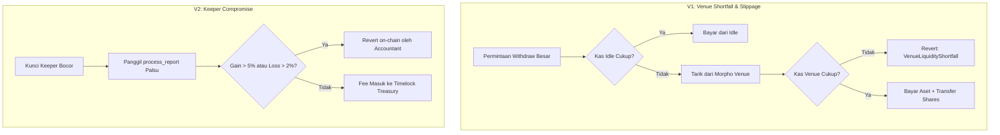

# AUDIT_SCOPE — Cakupan dan Panduan Review Keamanan Independen

Dokumen ini mendefinisikan **cakupan teknis**, **asumsi batas**, **invariant kritis**, dan **vektor ancaman** untuk peninjauan keamanan independen (*smart contract security review*) sebelum rilis terbatas Avenor Managed Strategy Vaults di Robinhood Chain (`4663`).

Tiket BMAD: `epic-security-and-limited-launch` / `story-define-review-scope-and-engage-independent-reviewer.md` (Tiket 7.1, Slice S6).

---

## 1. Aturan Keterlibatan & Prinsip Reviewer

1. **Independensi Mutlak:** Reviewer wajib independen dari penulis kode dan tim pengembang inti.
2. **Batas Klaim Keamanan:**
   - Tidak ada klaim *"audited"* untuk kode produk Avenor sebelum laporan akhir audit eksternal terbit dan seluruh temuan *Critical/High* tertutup.
   - Audit upstream Yearn V3 tahun 2023 (ChainSecurity, Statemind) diakui hanya untuk basis commit 2023 (`v3.0.2`), bukan untuk kombinasi pin 2026 atau kontrak adapter kita.
3. **Kriteria Kelulusan (Gate Rilis Terbatas):**
   - Temuan *Critical* dan *High*: **Nol (0) terbuka**. Wajib diperbaiki dengan kode regresi yang terverifikasi.
   - Temuan *Medium* dan *Low*: Wajib dimitigasi atau diterima secara tertulis (*documented accepted risk*) dengan pertimbangan arsitektur yang disetujui tim.

---

## 2. Cakupan Kode Sumber (In-Scope vs. Out-of-Scope)

```
packages/contracts/
├── src/
│   ├── strategies/
│   │   └── MorphoVaultStrategy.sol     [IN-SCOPE — PRIORITAS TINGGI]
│   ├── hooks/
│   │   └── DepositCapHook.sol          [IN-SCOPE — PRIORITAS TINGGI]
│   └── interfaces/
│       ├── Roles.sol                   [IN-SCOPE — PRIORITAS MEDIUM]
│       └── IMorphoVaultV2.sol          [IN-SCOPE — VALIDASI SIGNATURE]
├── script/
│   └── Deploy.s.sol                    [IN-SCOPE — PRIORITAS TINGGI]
└── test/
    ├── unit/                           [REFERENSI PENGUJIAN]
    ├── invariant/                      [REFERENSI INVARIANT]
    └── fork/                           [REFERENSI INTEGRASI ON-CHAIN]
```

### 2.1 Komponen In-Scope (Kode Baru Kita)

| Kontrak / Berkas | Baris (SLOC) | Bahasa | Fungsi Kritis yang Ditinjau |
|---|---|---|---|
| `MorphoVaultStrategy.sol` | 343 | Solidity 0.8.18 | Alokasi dana (`_deployFunds`), penarikan likuiditas (`_freeFunds`), pelaporan laba (`_harvestAndReport`), pembacaan batas likuiditas (`availableWithdrawLimit`), proteksi revert saat venue kekurangan kas (`VenueLiquidityShortfall`), manajemen allowance nol. |
| `DepositCapHook.sol` | 256 | Solidity 0.8.18 | Plafon global aset (`totalAssets`), plafon posisi per-wallet, allowlist fase terbatas, sifat *non-interfering* terhadap penarikan (`available_withdraw_limit` tidak pernah membatasi exit), kontrol governance timelock 48 jam. |
| `Deploy.s.sol` | 1.233 | Solidity 0.8.18 | Urutan wiring peran, inisialisasi timelock 48 jam & timelock darurat 6 jam, penyerahan `role_manager`, pencabutan hak deployer (`set_role(actor, 0)`), assert runtime bytecode prefix dan ekor immutable `VAULT_ORIGINAL`. |
| `DeployTestnet.s.sol` | 175 | Solidity 0.8.18 | Skrip deploy staging/rehearsal testnet 46630 dengan pengamanan kunci fail-closed (menolak `makeAddr` pada rantai non-lokal), bootstrap initial liquidity, wiring Safe governance 2/3, guardian, treasury, dan keeper. |
| `Roles.sol` | 63 | Solidity 0.8.18 | Definisi 14-bit izin akses Yearn V3, bitmask kombinasi governance (`3995`), emergency timelock (`4`), emergency pause (`8192`), dan keeper (`96`). |

### 2.2 Komponen Out-of-Scope (Upstream Dependencies)

Komponen berikut **tidak diaudit ulang dari nol**, melainkan ditinjau dari sisi **asumsi integrasi** dan kesesuaian antarmuka:
- **`VaultV3.vy@f449264f` (API `3.1.1`):** Core Yearn V3. Sumber kebenaran perbedaan terhadap versi yang diaudit 2023 dicatat di `docs/SECURITY_DIFF.md`.
- **`TokenizedStrategy` (`0x3110D1Eec90f0651C18e75AD37711A8777342504`):** Bytecode kanonik yang telah terpasang di Robinhood Chain (`4663`).
- **`Accountant.sol` (Yearn Periphery `@672de1c`):** Kontrak akuntansi biaya performa.
- **`steakUSDG` (`0xBeEff033F34C046626B8D0A041844C5d1A5409dd`):** Morpho Vault V2 pihak ketiga (21.808 byte kode di chain `4663`, `shareDecimals` 18, `totalAssets` `538856055994280` pada pin `118337511`). Alamat ini diverifikasi dengan `eth_getCode`, bukan diasumsikan.

---

## 3. Invariant Wajib yang Harus Dibuktikan

Reviewer diminta menguji integritas invariant berikut secara formal maupun empiris:

1. **Konservasi Total Aset (Solvabilitas Akuntansi):**
   $$\text{total\_assets} = \text{total\_idle} + \text{total\_debt}$$
   Tidak ada operasi alokasi, penarikan, atau laporan fee yang boleh merusak persamaan ini.
2. **Kemandirian Jalur Penarikan (Exit Freedom):**
   - Kondisi `DepositCapHook` (misal: allowlist aktif, cap global tercapai, atau cap dompet penuh) **sama sekali tidak boleh** memblokir fungsi `withdraw` atau `redeem`.
   - Penarikan hanya boleh dibatasi oleh likuiditas kas aktual venue, bukan oleh kegagalan logika hook.
3. **Pembatasan Wewenang Kunci Panas (Keeper Containment):**
   - Pemegang kunci `REPORTING_MANAGER` dan `DEBT_MANAGER` (Keeper hot wallet) **tidak memiliki jalur teknis** untuk mentransfer aset vault ke alamat selain strategi yang terdaftar atau venue yang terkunci.
   - Laporan keeper wajib tertahan oleh batas revert `Accountant.maxGain` (5%) dan `Accountant.maxLoss` (2%).
4. **Isolasi Peran Darurat (Dual-Speed Governance Separation):**
   - Safe Guardian (pemegang `EMERGENCY_MANAGER`) **tidak boleh** menjadi proposer pada Timelock Governance (48 jam).
   - Safe Guardian hanya dapat memicu de-risking strategi (`FORCE_REVOKE_MANAGER`) melalui Timelock Darurat dengan jeda minimal **6 jam**, mencegah eksekusi instan yang menurunkan nilai buku share secara sepihak.
   - Tindakan `setPaused(true)` dapat dilakukan instan oleh Guardian hanya untuk membendung eksploit, dengan kesadaran bahwa seluruh penarikan ikut tertahan sementara.
5. **Proteksi Manipulasi Inflasi Share Awal (Anti Share-Inflation):**
   - Vault yang diinisialisasi wajib memiliki *dead shares* permanen (1.000 USDG ditransfer ke `0xdEaD`) serta pembatasan minimum deposit (10 USDG = `10_000_000n` micro-USDG ditegakkan di SDK dan antarmuka web) untuk mematikan vektor serangan donasi ERC-4626.

---

## 4. Vektor Ancaman Utama (Adversary Focus Areas)

Reviewer diminta memberikan perhatian khusus pada skenario eksploit berikut:



### 4.1 Vektor V1: Manipulasi `_freeFunds` dan Penarikan Parsial
- **Risiko:** TokenizedStrategy upstream memperlakukan shortfall penarikan dari strategi sebagai *unrealised loss*, yang dapat membakar seluruh share pengguna tanpa mengembalikan dana setimpal.
- **Fokus Audit:** Pastikan fungsi `MorphoVaultStrategy._freeFunds` me-revert dengan `VenueLiquidityShortfall` jika aset yang ditarik dari venue lebih kecil dari permintaan, sehingga pengguna terlindungi oleh `max_loss` eksplisit mereka.

### 4.2 Vektor V2: Kompromi Kunci Panas Keeper
- **Risiko:** Penyerang yang menguasai EOA keeper memanggil `process_report` secara berulang untuk memicu penerbitan share fee performa.
- **Fokus Audit:** Verifikasi bahwa fee hanya mengalir ke `performanceFeeRecipient` (kontrak Timelock/Treasury, bukan keeper) dan tertahan oleh ambang `maxGain` 5%.

### 4.3 Vektor V3: Reentrancy & Flash Loan pada `DepositCapHook`
- **Risiko:** Penyerang meminjam modal besar via flash loan untuk mengisi cap global atau memanipulasi perhitungan `convertToAssets` sesaat sebelum transaksi korban.
- **Fokus Audit:** Verifikasi penggunaan `ReentrancyGuardUpgradeable` / non-reentrant execution pada hook serta perhitungan saldo riil tanpa reliance pada state transien.

### 4.4 Vektor V4: Eskalasi Wewenang Deployer
- **Risiko:** Kunci broadcaster deployer masih memiliki izin `set_role` setelah deployment selesai.
- **Fokus Audit:** Periksa logika pelepasan peran pada [Deploy.s.sol](../packages/contracts/script/Deploy.s.sol) yang memanggil `set_role(actor, 0)` tepat sebelum `transfer_role_manager(timelock)`.

---

## 5. Paket Penyerahan Reviewer (Reviewer Hand-Off Package)

Reviewer eksternal akan menerima repositori lengkap dengan referensi wajib:

1. **Kode Kontrak & Script:** Direktori [packages/contracts/](../packages/contracts/) (Solidity 0.8.18, 5 berkas in-scope total 2.070 SLOC).
2. **Dokumen Arsitektur & Peran:**
   - [ARCHITECTURE.md](ARCHITECTURE.md) (ADR-1 s.d. ADR-15)
   - [ROLE_PERMISSION_MATRIX.md](ROLE_PERMISSION_MATRIX.md) (Peta 14 bit dan penugasan)
   - [WITHDRAWAL_SEMANTICS.md](WITHDRAWAL_SEMANTICS.md) (12 skenario penarikan)
   - [SECURITY_DIFF.md](SECURITY_DIFF.md) (Delta audit 2023 vs. pin 2026)
   - [FEE_CONFIG.md](FEE_CONFIG.md) (Konfigurasi akuntansi fee dan batas kebijakan vs kontrak)
   - [DEPLOYMENT.md](DEPLOYMENT.md) (Tahapan dan assert runtime)
   - [RUNBOOK.md](RUNBOOK.md) (SOP 7 insiden operasional terhubung kode monitor)
   - [TESTNET_EVIDENCE.md](TESTNET_EVIDENCE.md) & [LIFECYCLE_EVIDENCE.md](LIFECYCLE_EVIDENCE.md) (Bukti on-chain testnet 46630)
3. **Instruksi Eksekusi Uji Mandiri:**
   - Reproduksi lokal satu perintah: `python scripts/verify-all.py` (320 tests monorepo: 124 Foundry + 12 SDK + 38 Indexer + 24 Keeper + 122 Web)
   - Uji fork pin jaringan riil: `python scripts/fork-test.py`
   - Uji verifikasi serah-terima governance: `python scripts/check-handover.py`
   - Uji drill lifecycle testnet: `python scripts/testnet-lifecycle-drill.py`
