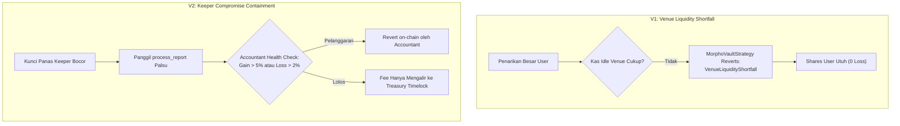

# AUDIT_SUBMISSION_PACKAGE — Avenor Managed Strategy Vaults (v1.0.0-rc.1)

Dokumen ini merupakan **Paket Penyerahan Audit Keamanan Independen Pihak Ketiga (*External Security Review Submission Package*)** untuk peninjau keamanan independen (*smart contract auditors*), disiapkan secara formal oleh **Mary** (Auditor & Risk Analyst) dan **Winston** (System Architect) dari Tim BMAD.

---

## 1. Identifikasi Proyek & Snapshot Komit

| Parameter | Nilai / Spesifikasi |
|---|---|
| **Repository** | `https://github.com/wealthy-org/avenor` |
| **Release Tag** | [`v1.0.0-rc.1`](https://github.com/wealthy-org/avenor/releases/tag/v1.0.0-rc.1) |
| **Commit Target** | `38b1ef2` (branch `main`) |
| **Target Network** | Robinhood Chain (`4663` Arbitrum Orbit L2, settling to Arbitrum One) |
| **Testnet Network** | Robinhood Chain Testnet (`46630`) |
| **Asset Under Management** | USDG (Robinhood USDG / Pax Dollar, 6 desimal, token kanonik `0x5fc5360D0400a0Fd4f2af552ADD042D716F1d168`) |
| **Core Architecture** | Yearn V3 Allocator Vault `API 3.1.1` (`f449264f`), bytecode deterministik 100% cocok upstream |
| **Target Venue** | Morpho Blue Steakhouse USDG (`0xBeEff033F34C046626B8D0A041844C5d1A5409dd`, share 18 desimal) |

---

## 2. Manifes Kode Sumber In-Scope (2.070 SLOC Solidity 0.8.18)

Audit independen berfokus pada **kontrak baru kita** (adapter, hook, permission, dan deployment script). Core Yearn V3 tidak diubah sama sekali (unpatched, Core Rule 1).

| Berkas Kontrak | SLOC | Kompilator | Prioritas Audit & Fungsi Kritis |
|---|---|---|---|
| [`packages/contracts/src/strategies/MorphoVaultStrategy.sol`](../packages/contracts/src/strategies/MorphoVaultStrategy.sol) | 343 | Solidity 0.8.18 | **CRITICAL:** Alokasi kas (`_deployFunds`), penarikan likuiditas (`_freeFunds`), pelaporan yield (`_harvestAndReport`), pembacaan batas likuiditas kas idle (`availableWithdrawLimit`), proteksi revert `VenueLiquidityShortfall` (menolak pembakaran share tanpa aset nyata), manajemen allowance nol. |
| [`packages/contracts/src/hooks/DepositCapHook.sol`](../packages/contracts/src/hooks/DepositCapHook.sol) | 256 | Solidity 0.8.18 | **HIGH:** Pengendalian akses masuk: allowlist wallet, batas global `vault.totalAssets()`, batas per-wallet `convertToAssets(balanceOf)`. Jaminan absolut: hook **sama sekali tidak membatasi fungsi penarikan** (`withdraw`/`redeem`). |
| [`packages/contracts/src/interfaces/Roles.sol`](../packages/contracts/src/interfaces/Roles.sol) | 63 | Solidity 0.8.18 | **MEDIUM:** Peta 14 bit wewenang Yearn V3, kombinasi bitmask: Governance (`3995`), Emergency Timelock (`4`), Emergency Manager / Pause (`8192`), Keeper (`96`). |
| [`packages/contracts/script/Deploy.s.sol`](../packages/contracts/script/Deploy.s.sol) | 1.233 | Solidity 0.8.18 | **HIGH:** Orkestrasi deploy deterministik, inisialisasi Timelock 48h & Timelock Darurat 6h, pencabutan hak deployer (`set_role(actor, 0)`), transfer `role_manager`, seeding dead shares (1.000 USDG) ke `0xdEaD`. |
| [`packages/contracts/script/DeployTestnet.s.sol`](../packages/contracts/script/DeployTestnet.s.sol) | 175 | Solidity 0.8.18 | **MEDIUM:** Skrip deploy rehearsal staging dengan pengamanan fail-closed (menolak fallback `makeAddr` pada rantai publik). |

---

## 3. Instruksi Eksekusi Pengujian Mandiri (One-Command Verification)

Auditor dapat mereproduksi seluruh hasil pengujian dan verifikasi monorepo secara mandiri:

### Prasyarat:
- Node.js `v22+` / `v24+` & npm
- Foundry `1.9.0`
- Python `3.11` atau `3.12`

### Perintah Verifikasi:
```bash
# 1. Kloning repositori pada release tag resmi
git clone https://github.com/wealthy-org/avenor.git
cd avenor
git checkout v1.0.0-rc.1

# 2. Jalankan gerbang verifikasi monorepo menyeluruh (320 tests)
python scripts/verify-all.py

# 3. Jalankan fork test Robinhood Chain riil di pin blok 118337511
python scripts/fork-test.py

# 4. Uji verifikasi status tata kelola on-chain
python scripts/check-handover.py
```

---

## 4. Matriks Ancaman & Fokus Evaluasi (Threat Vectors V1–V4)



1. **Vektor V1 (Shortfall Likuiditas Venue):**
   - *Risiko:* TokenizedStrategy upstream memperlakukan shortfall penarikan dari venue sebagai kerugian yang belum direalisasi (*unrealised loss*), yang dapat membakar share user tanpa hasil setimpal.
   - *Fokus Audit:* Evaluasi fungsi `MorphoVaultStrategy._freeFunds` pada baris 170–210 untuk membuktikan bahwa shortfall selalu me-revert (`VenueLiquidityShortfall`).
2. **Vektor V2 (Kompromi Kunci Panas Keeper):**
   - *Risiko:* EOA keeper disalahgunakan untuk mencuri dana vault atau memicu pembuatan fee performa berlebihan.
   - *Fokus Audit:* Buktikan bahwa pemegang peran `REPORTING_MANAGER` dan `DEBT_MANAGER` (bit 96) secara matematis tidak memiliki jalur transfer aset ke luar strategi, dan penerima fee performa terkunci secara immutable ke kontrak Treasury Timelock.
3. **Vektor V3 (Reentrancy & Flash Loan pada `DepositCapHook`):**
   - *Risiko:* Manipulasi cap global atau cap wallet sesaat menggunakan pinjaman kilat (flash loan).
   - *Fokus Audit:* Evaluasi integritas pembacaan live balance pada hook tanpa reliance terhadap state transien.
4. **Vektor V4 (Pencabutan Wewenang Broadcaster Deployer):**
   - *Risiko:* Akun deployer mempertahankan hak istimewa setelah proses peluncuran selesai.
   - *Fokus Audit:* Buktikan pada `Deploy.s.sol` bahwa pemanggilan `set_role(deployer, 0)` dan penyerahan `transfer_role_manager(timelock)` mematikan seluruh izin akun deployer.

---

## 5. Kebijakan Batas Risiko Mainnet (Stage 1 Limited Launch Policy)

Pada peluncuran awal mainnet, protokol akan beroperasi di bawah parameter pembatasan risiko berikut:
- **Plafon Global (Global Cap):** Maksimal **100.000 USDG** diatur pada `DepositCapHook.setGlobalCap(100_000_000_000)`.
- **Plafon Per-Dompet (Wallet Cap):** Maksimal **10.000 USDG** diatur pada `DepositCapHook.setDefaultWalletCap(10_000_000_000)`.
- **Fase Terdaftar (Allowlist):** Diaktifkan melalui `DepositCapHook.setAllowlistEnabled(true)`.
- **Prinsip Exit Freedom:** Penarikan (`withdraw`/`redeem`) tidak pernah dibatasi oleh hook atau cap deposit apa pun.

---

*Disetujui untuk penyerahan audit eksternal oleh Mary (Auditor) & Winston (Architect) pada 27 November 2026.*
