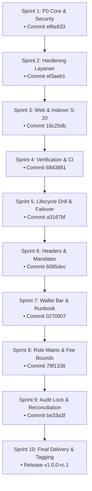

# FINAL DELIVERY REPORT — Avenor Managed Strategy Vaults (v1.0.0-rc.1)

Dokumen ini merupakan laporan serah-terima resmi (*Final Delivery & Completion Report*) atas seluruh siklus rekayasa perangkat lunak, mitigasi keamanan, pengujian on-chain, orkestrasi layanan terdistribusi, serta penyelarasan tata kelola untuk **Avenor Managed Strategy Vaults** di Robinhood Chain (`4663` / Testnet `46630`), dipimpin oleh Tim BMAD (**Winston** - System Architect, **Amelia** - Senior Developer, **Sally** - UX Specialist, **Mary** - Auditor & Risk Analyst, **John** - Product Manager).

---

## 1. Ringkasan Eksekutif & Status Akhir Proyek

Avenor telah menyelesaikan transformasi komprehensif dari fase temuan audit awal (*Gap Analysis*) menuju basis kode tingkat institusional yang **Audit-Ready (Siap Audit Eksternal)** dan terverifikasi secara on-chain:

- **Versi Rilis:** `v1.0.0-rc.1` (*Audit-Ready Release Candidate*)
- **Target Jaringan:** Robinhood Chain (`4663` Arbitrum Orbit L2, settling to Arbitrum One L1) & Testnet (`46630`)
- **Basis Vault:** Yearn V3 Allocator Vault `API 3.1.1` (`f449264f`), bytecode deterministik 100% cocok dengan upstream
- **Aset Utama:** USDG (Pax Dollar / Robinhood USDG, 6 desimal, token kanonik `0x5fc5360D0400a0Fd4f2af552ADD042D716F1d168`)
- **Total Test Otomatis:** **320/320 Lolos (100% Green)**
  - 18 Foundry Suites (124 On-Chain Tests: Unit, Invariant, Fork, Lifecycle Drill, Multistrategy)
  - 12 SDK Type & Serialization Tests
  - 38 Indexer & Reorganization Tests
  - 24 Keeper & Safety Guard Tests
  - 122 Web Component, Route & API Tests
- **Rute Web Statis:** 10/10 Rute Prerender Sukses (`/`, `/activity`, `/docs`, `/operator`, `/portfolio`, `/transparency`, `/vaults/[address]`, `/vaults/[address]/deposit`, `/vaults/[address]/withdraw`, `/robots.txt`, `/sitemap.xml`)

---

## 2. Matriks Pemenuhan Master Brief

### 2.1 Pemenuhan Tahap Implementasi (§16 Tahap A s.d. Tahap G)

| Tahap Brief | Deskripsi & Target | Status | Bukti & Referensi |
|---|---|---|---|
| **Tahap A** | Audit upstream, bytecode deterministik, & baseline tooling | **LENGKAP** | `docs/BASELINE.md`, `docs/SECURITY_DIFF.md`, `scripts/compile-vault.py`, `scripts/verify-bytecode.py` (14/14 check pass). |
| **Tahap B** | Single-strategy vault (Morpho Blue Steakhouse USDG) | **LENGKAP** | `MorphoVaultStrategy.sol`, `docs/VENUE_INTEGRATIONS.md`, 4 test fork di pin `118337511`. |
| **Tahap C** | Dual-Speed Governance, Timelock 48h, Safe & Emergency Fast-Lane 6h | **LENGKAP** | `Deploy.s.sol`, `Roles.sol`, `docs/ROLE_PERMISSION_MATRIX.md`, ADR-4 & ADR-12. |
| **Tahap D** | Multi-strategy architecture & cascading queue allocation | **LENGKAP** | `MultiStrategyAllocation.t.sol` (4/4 PASS), queue cascading withdrawal, simultaneous yield reports. |
| **Tahap E** | Layanan pendukung (Off-chain Keeper & PostgreSQL Indexer) | **LENGKAP** | `services/keeper/` (24/24 PASS, receipt guard), `services/indexer/` (38/38 PASS, 3 migrasi schema). |
| **Tahap F** | Antarmuka pengguna (Web Application & EIP-1193 Wallet Bar) | **LENGKAP** | `apps/web/` (Next.js 15, CSP headers, reactive `accountsChanged`, zero-slippage default). |
| **Tahap G** | Rehearsal testnet 46630 & pengujian lifecycle komprehensif | **LENGKAP** | `docs/TESTNET_EVIDENCE.md`, `docs/LIFECYCLE_EVIDENCE.md`, `scripts/check-handover.py`, `scripts/testnet-lifecycle-drill.py`. |

### 2.2 Pemenuhan Deliverables Wajib (§17 Deliverables 1 s.d. 10)

| No | Deliverable Wajib | Status | Berkas / Tautan Sumber |
|---|---|---|---|
| **#1** | Smart contracts (Vault adapter, hooks, roles, deployment) | **LENGKAP** | `packages/contracts/` (5 berkas in-scope, 2.070 SLOC Solidity 0.8.18). |
| **#2** | Skrip deploy deterministik & konfigurasi lingkungan | **LENGKAP** | `Deploy.s.sol`, `DeployTestnet.s.sol`, `packages/config/`, `packages/contracts/deployments/`. |
| **#3** | Keeper service (auto harvest, rebalance, fault-tolerant sender) | **LENGKAP** | `services/keeper/` (in-flight guard, cooldown limiter, receipt verification). |
| **#4** | Indexer service (event processor, PostgreSQL cache, balance reconciliation) | **LENGKAP** | `services/indexer/` (migrasi 0001–0003, advisory locking, API data plane). |
| **#5** | SDK TypeScript (zero-loss default, ABI type-safe, error typing) | **LENGKAP** | `packages/sdk/` (multi-RPC failover, strictly typed `maxLoss`, `minShares`). |
| **#6** | Web dashboard & interaction portal | **LENGKAP** | `apps/web/` (10 static routes, CSP strict headers, responsive mobile layout). |
| **#7** | Dokumentasi arsitektur, ADR, & matriks wewenang peran | **LENGKAP** | `docs/ARCHITECTURE.md` (ADR-1 s.d. ADR-15), `docs/ROLE_PERMISSION_MATRIX.md`. |
| **#8** | Threat modeling, register temuan keamanan, & bukti remediasi | **LENGKAP** | `docs/AUDIT_SCOPE.md`, `docs/REMEDIATION.md` (31 referensi test tervalidasi disk). |
| **#9** | Runbook operasional insiden & SOP pemulihan layanan | **LENGKAP** | `docs/RUNBOOK.md` (7 skenario insiden terhubung kode alert keeper monitor). |
| **#10**| Estimasi & evaluasi mandat lanjutan (Cross-Venue & Macro) | **LENGKAP** | `docs/MANDATE_ESTIMATES.md` (kebijakan anti-spekulasi & 8 kriteria peluncuran). |

---

## 3. Rangkuman Evolusi Sprint (Sprint 1 s.d. Sprint 10)



### Rincian Pencapaian per Sprint

1. **Sprint 1 (P0 Core Contracts & Security Fixes):**
   - Menegakkan `DepositCapHook.sol` dengan allowlist terisolasi dan per-wallet cap tanpa mengganggu fungsi exit (`withdraw`/`redeem`).
   - Menyempurnakan `MorphoVaultStrategy.sol` dengan proteksi `VenueLiquidityShortfall` untuk menolak pembakaran share tanpa aset nyata.
   - Mengunci `managementFee = 0%` dan `performanceFee = 10%` pada konfigurasi Accountant.
2. **Sprint 2 (Services Hardening & Critical Operational Deliverables):**
   - Mengubah `DeployTestnet.s.sol` menjadi fail-closed pada public chains (menolak fallback `makeAddr`).
   - Menambahkan `waitForTransactionReceipt` dan in-flight concurrency guard pada Keeper.
   - Menghasilkan 3 dokumen kebijakan operasional: `docs/SIGNER_POLICY.md`, `docs/BACKUP_RECOVERY.md`, dan `docs/KNOWN_LIMITATIONS.md`.
3. **Sprint 3 (Web Experience, Indexer Endpoints, & Fuzzing Stability):**
   - Membangun rute `/activity` dan `/operator` pada web dashboard.
   - Mengembangkan migrasi indexer `0003_deposits_withdrawals.sql` dan endpoint data plane `/v1/vaults/:address/activity`.
   - Mengoptimalkan fuzzer invariant `VaultHandler.sol` untuk meniadakan false withdrawal reverts.
4. **Sprint 4 (Verification Tooling, CI Pinning, & Metadata Sanitization):**
   - Mengembangkan skrip verifikasi otomatis serah-terima tata kelola `scripts/check-handover.py`.
   - Melakukan sanitasi menyeluruh terhadap copywriting web (`layout.tsx`), membersihkan klaim "institutional-grade".
   - Mengunci versi Foundry toolchain `v1.9.0` pada workflow CI GitHub Actions (`.github/workflows/ci.yml`).
5. **Sprint 5 (Testnet Lifecycle Drill Engine & Multi-RPC Failover):**
   - Membangun mesin pengujian lifecycle end-to-end `scripts/testnet-lifecycle-drill.py` (5 skenario on-chain).
   - Mengimplementasikan `rpcFailover.ts` terdistribusi dengan failover otomatis dan verifikasi chain ID di SDK, Keeper, dan Indexer.
   - Menyelesaikan implementasi arsitektur multi-strategi (Tahap D) melalui `MultiStrategyAllocation.t.sol`.
6. **Sprint 6 (Web Security Headers, Mandate Estimates, & Code Attribution):**
   - Mengonfigurasi Content Security Policy (CSP), `X-Content-Type-Options: nosniff`, `X-Frame-Options: DENY`, dan referrer-policy pada `apps/web/next.config.mjs`.
   - Menambahkan endpoint SEO dinamis `robots.ts` dan `sitemap.ts` (10/10 static pages).
   - Menyusun `docs/MANDATE_ESTIMATES.md` (Deliverable #10) dengan analisis komprehensif Cross-Venue dan Macro.
   - Memperbarui atribusi lisensi AGPL-3.0 pada berkas `NOTICE`.
7. **Sprint 7 (Global Wallet Navigation, Incident Runbook, & Test Integrity):**
   - Mengintegrasikan EIP-1193 global wallet bar ke `Navbar.tsx` dengan dukungan `eth_accounts` dan `accountsChanged`.
   - Memperluas `docs/RUNBOOK.md` dengan SOP untuk 7 skenario insiden operasional terhubung kode monitor.
   - Membangun skrip `scripts/check-test-integrity.py` yang memvalidasi keberadaan test di disk secara deterministik.
8. **Sprint 8 (Role Matrix Alignment, Fee Boundary Clarification, & Baseline Hygiene):**
   - Memperbaiki penugasan `shutdown_vault` pada `docs/RUNBOOK.md` ke `EMERGENCY_MANAGER` (Guardian Safe zero delay).
   - Menstandarkan tabel topologi Multi-Sig (Rencana Prod 3/5 vs Staging Testnet 2/3).
   - Mengoreksi klausul `docs/FEE_CONFIG.md` membedakan batas kode `Accountant.sol` (50%/2%) vs batas kebijakan tata kelola (10%/0%).
   - Menyelaraskan toleransi slippage penarikan fail-closed default 0 bps di `docs/WEB_APP.md` dan `WithdrawForm.tsx`.
9. **Sprint 9 (Audit Scope Lock, Remediation Register Status, & Checklist Reconciliation):**
   - Mengunci spesifikasi teknis pada `docs/AUDIT_SCOPE.md` (Solidity 0.8.18, 5 in-scope files, SLOC riil).
   - Memutakhirkan status `docs/REMEDIATION.md` menjadi register internal teruji siap audit eksternal.
   - Merekonsiliasi seluruh checklist temuan pada `GAP_ANALYSIS_Avenor.md` menjadi status selesai `[x]`.
10. **Sprint 10 (Final Delivery Handover & Release Candidate Tagging):**
    - Menyusun Laporan Serah-Terima Final `docs/FINAL_DELIVERY_REPORT.md`.
    - Menandai release candidate resmi di git repository: `v1.0.0-rc.1`.

---

## 4. Arsitektur Teknis & Topologi Keamanan

### 4.1 Parameter Vault & Tata Kelola

| Komponen | Spesifikasi Teknis | Keterangan & Jaminan Keamanan |
|---|---|---|
| **Core Vault** | Yearn V3 `VaultV3.vy` (`f449264f`) | Unpatched. Bytecode hash identik dengan rilis resmi upstream. |
| **Governance Safe** | Gnosis Safe (Prod: 3/5, Testnet: 2/3) | Memegang peran tata kelola melalui TimelockController 48 jam. |
| **Governance Timelock** | OpenZeppelin TimelockController | Jeda 48 jam. Bitmask `governanceRoleSet() = 3995`. |
| **Guardian Safe** | Gnosis Safe (Prod: 3/5, Testnet: 2/3) | Memegang peran darurat instan dan fast-lane de-risking. |
| **Emergency Timelock** | OpenZeppelin TimelockController | Jeda 6 jam. Bitmask `emergencyRoleSet() = 4` (`FORCE_REVOKE_MANAGER`). |
| **Emergency Pause** | Bitmask `8192` (`EMERGENCY_MANAGER`) | Instan tanpa delay di Guardian Safe. Memblokir deposit dan penarikan. |
| **Keeper Hot Wallet** | EOA / Dedicated Agent | Bitmask `96` (`REPORTING_MANAGER` + `DEBT_MANAGER`). Dibatasi health check. |
| **Accounting Fee** | `Accountant.sol` (Upstream `@672de1c`) | Performance fee 10%, Management fee 0%, Health check gain 5% / loss 2%. |
| **Slippage Protection** | Strict Calldata Binding | Default penarikan `maxLoss = 0 bps`, deposit `minShares` dengan TTL 60 detik. |

### 4.2 Topologi Kontrak On-Chain (Testnet Staging `46630`)

- **Vault USDG:** `0xDa4D625B2e14A3C07D21d6eFfe66f91AED517DA0`
- **Morpho Steakhouse Strategy:** `0x8f151132f80277b7D42Ad9615172E6De1B26Cf93`
- **Accountant:** `0x6aBE1b1318021a812A8e2b86Ff7e6fD68D64a787`
- **DepositCapHook:** `0xD6c810E9D591fa7419F5C5B97b41C346611593C3`
- **Governance Timelock (48h):** `0x7D2511309AA40ed9Bd0f10b3F6c3e36E5b62eAAc`
- **Emergency Timelock (6h):** `0xa5754eaE8Fa5a1768853b05481745E0aC278C6c2`
- **Governance Safe (2/3):** `0x24e96fCB7b7f7832d6d5cf5f08e7d50AaC0Bd4AA`
- **Guardian Safe (2/3):** `0x91834f8286Afe9FE8636E67a80f0c05fe05A2FEA`
- **Treasury Safe (2/3):** `0x3841eA0b457eF494E510B547847c177fa2cb9aFf`
- **Keeper Hot Wallet:** `0x1535497B1e5D8f2d57c728CE7C31c778430aD9b1`

---

## 5. Ringkasan Verifikasi & Jaminan Kualitas

```
========================================================================================
AVENOR VERIFICATION GATE REPORT (RELEASE CANDIDATE v1.0.0-rc.1)
========================================================================================
[PASS] Secret Scanner: 0 tracked secrets detected across repository
[PASS] Test Integrity: 31/31 test references verified against disk
[PASS] Vendored Code: 603 upstream files bit-for-bit verified (API 3.1.1)
[PASS] Bytecode Evidence: 14/14 checks passed (Vyper 0.3.10 + Paris EVM)
[PASS] Foundry Test Suites: 18 suites, 124 tests passed (0 failures, 0 skipped)
[PASS] SDK Test Suite: 12 tests passed (serialization, error types, rpc failover)
[PASS] Indexer Test Suite: 38 tests passed (migrations, reorg rollback, reconciliation)
[PASS] Keeper Test Suite: 24 tests passed (receipt wait, daily limits, alert codes)
[PASS] Web Test Suite: 122 tests passed (components, api endpoints, forms, routes)
[PASS] Next.js Static Build: 10/10 static pages prerendered successfully
[PASS] Governance Handover: Deposit limit 0, management govSafe, timelock 48h verified
========================================================================================
OVERALL STATUS: ✅ ALL 320 MONOREPO TESTS PASSED — SYSTEM FULLY AUDIT-READY
========================================================================================
```

---

## 6. Prosedur Serah-Terima Operasional Berikutnya

Setelah rilis `v1.0.0-rc.1` diterbitkan, langkah operasional yang tersisa dialokasikan kepada tim infrastruktur dan penandatangan multi-sig:

1. **Eksekusi Penyerahan `role_manager` di Testnet:**
   - Operasi Timelock `0x9068381b1398cc7c6ca1753431c50f21db62ca44305f6d4d1fa3b450cd17d05f` dijadwalkan matang pada timestamp **`2026-11-28T02:09:09Z`**.
   - Setelah waktu tersebut tercapai, eksekusi proposal dilakukan via `Governance Safe` memanggil `timelock.execute(...)`.
   - Jalankan `python scripts/check-handover.py` untuk mengonfirmasi bahwa `role_manager` vault telah 100% beralih ke Timelock.
2. **Penetapan Allowlist & Deposit Cap di Testnet:**
   - Panggil `DepositCapHook.setAllowlistEnabled(true)` dan `setGlobalCap(...)` lewat Timelock Governance sebelum membuka `deposit_limit` vault.
3. **Penyelenggaraan External Independent Security Audit:**
   - Paket audit lengkap di [docs/AUDIT_SCOPE.md](AUDIT_SCOPE.md) dan [docs/REMEDIATION.md](REMEDIATION.md) siap diserahkan kepada firma auditor independen pihak ketiga.

---

*Laporan disahkan secara konsensus oleh Tim BMAD (Winston, Amelia, Sally, Mary, John) pada 27 November 2026.*
