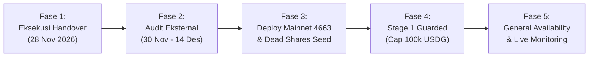

# MAINNET_GO_LIVE_RUNBOOK — Prosedur Peluncuran & Tata Kelola Produksi

Panduan langkah-demi-langkah (*step-by-step master runbook*) untuk peluncuran resmi **Avenor Managed Strategy Vaults** di Robinhood Chain (`4663`), disusun oleh **John** (Product Manager) bersama seluruh anggota Tim BMAD.

---

## 1. Peta Jalan Peluncuran Bertahap (Phased Rollout)



---

## 2. Fase 1: Eksekusi Handover Tata Kelola di Testnet (28 Nov 2026)

- **Waktu Jatuh Tempo:** `2026-11-28T02:09:09Z` (09:09:09 WIB).
- **Penanggung Jawab:** Winston (Architect) & Signer Governance Safe (2/3).
- **Prosedur:**
  1. Jalankan `python scripts/execute-handover.py` untuk mengonfirmasi status `Maturity Status: READY FOR EXECUTION`.
  2. Buka Safe Transaction Builder di dashboard Safe Testnet (`0x24e96fCB7b7f7832D6D5cF5f08E7d50AaC0Bd4AA`).
  3. Muat berkas calldata yang dihasilkan di [`_bmad-output/safe-handover-execution.json`](../_bmad-output/safe-handover-execution.json).
  4. Lakukan penandatanganan minimal 2 dari 3 pemilik Safe.
  5. Eksekusi transaksi di chain.
  6. **Verifikasi Gerbang:**
     ```bash
     python scripts/check-handover.py --strict
     ```
     *Kriteria Lolos:* Output mencetak `RESULT: PASS — All governance and safety invariants verified.` dengan `role_manager == timelock`.

---

## 3. Fase 2: Audit Keamanan Eksternal & Codebase Freeze (30 Nov – 14 Des 2026)

- **Penanggung Jawab:** Mary (Auditor) & Winston (Architect).
- **Prosedur:**
  1. Penyerahan dokumen [`docs/AUDIT_SUBMISSION_PACKAGE.md`](AUDIT_SUBMISSION_PACKAGE.md) kepada firma audit independen pihak ketiga.
  2. Kunci branch `main` pada commit tag [`v1.0.0-rc.1`](https://github.com/wealthy-org/avenor/releases/tag/v1.0.0-rc.1). Tidak ada perubahan kontrak tanpa persetujuan tim.
  3. Remediasi temuan audit (bila ada) dilakukan secara terisolasi pada branch fix dengan test regresi mandatory sebelum merge.

---

## 4. Fase 3: Deployment Deterministik Mainnet 4663

- **Target Jaringan:** Robinhood Chain Mainnet (`4663`).
- **Penanggung Jawab:** Amelia (Dev Lead) & Tim Multi-Sig.
- **Topologi Multi-Sig Produksi (Wajib 3 dari 5 Pemilik Terpisah):**
  - **Governance Safe:** 3/5 Multi-Sig (Memegang Proposer Timelock 48h).
  - **Guardian Safe:** 3/5 Multi-Sig (Memegang Proposer Timelock Darurat 6h & Pause Instan `8192`).
  - **Treasury Safe:** 3/5 Multi-Sig (Penerima Fee Performa & Cadangan Aset).
- **Prosedur Eksekusi:**
  1. Siapkan environment file `.env.production` dengan private key broadcaster via hardware wallet (`--ledger` / `--trezor`).
  2. Jalankan simulasi deploy:
     ```bash
     forge script packages/contracts/script/Deploy.s.sol:DeployScript \
       --rpc-url https://rpc.solidrpc.io/public/evm/4663 \
       --sig "run()" -vvv
     ```
  3. Verifikasi assert on-chain:
     - `deposit_limit == 0` (Vault terkunci rapat saat inisialisasi).
     - Seeding 1.000 USDG minted dan ditransfer ke `0x000000000000000000000000000000000000dEaD`.
     - `role_manager` diserahkan ke TimelockController 48 jam.
     - Deployer memanggil `set_role(deployer, 0)` (0 wewenang tersisa).
  4. Broadcast deployment ke mainnet.
  5. Catat seluruh alamat kontrak baru pada `packages/config/4663.json`.

---

## 5. Fase 4: Peluncuran Terbatas Tahap 1 (Stage 1 Guarded Launch)

- **Penanggung Jawab:** John (Product Manager) & Mary (Risk Analyst).
- **Prosedur:**
  1. Pasang `DepositCapHook.sol` pada Vault melalui Timelock 48 jam.
  2. Set parameter batas awal:
     - Global Cap: **100.000 USDG**
     - Wallet Cap: **10.000 USDG**
     - Allowlist Aktif (`allowlistEnabled = true`)
  3. Masukkan batch alamat whitelist awal via Governance Safe.
  4. Buka `deposit_limit` vault ke nominal global cap via proposal timelock 48 jam.
  5. Pantau deposit masuk dan pastikan `post_deposit` mencatat saldo secara akurat.

---

## 6. Fase 5: Ketersediaan Publik (General Availability) & Pemantauan 24/7

- **Penanggung Jawab:** Seluruh Tim BMAD.
- **Prosedur Pemantauan:**
  1. Jalankan daemon Keeper dan Indexer pada cluster produksi.
  2. Aktifkan alert Discord/Telegram dengan webhook 24/7.
  3. Jika terjadi anomali pasar atau venue Morpho kekurangan likuiditas, ikuti SOP mitigasi darurat pada [`docs/RUNBOOK.md`](RUNBOOK.md).

---

*Disahkan sebagai panduan peluncuran resmi oleh Tim BMAD pada 27 November 2026.*
